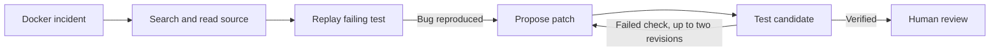

# Bug Investigator

Try booking two seats in the React demo and watch Bug Investigator diagnose the checkout error. It finds the relevant source lines, proposes a fix, and tests it in Docker. You review the diff in Streamlit before the app applies it locally or opens a pull request.

> **[View the public A1 + A2 investigation in LangSmith][checkout-trace]**
>
> Anyone can open this trace without signing in. Follow the checkout failure from source search to the first verified patch.

## Run the demo

### Quick start

You'll need **Git**, **Python 3.14**, and **Docker with Compose**. Start Docker first. An **OpenAI API key** is the only credential you need for automatic diagnosis. LangSmith tracing and GitHub publication are optional.

1. Clone the investigator and enter its directory.

   ```sh
   git clone https://github.com/aikastor/bug-investigator.git
   cd bug-investigator
   ```

2. Create a private `.env` file in that directory and add your key. You can also supply it through the environment. The worker uses `gpt-6.1-sol`.

   ```dotenv
   OPENAI_API_KEY=your-key
   ```

3. Start the demo.

   ```sh
   python3.14 demo.py
   ```

The launcher prepares Python, clones the [seat-booking app](https://github.com/aikastor/faulty-app) beside the investigator, and builds the browser-test image if needed. For later runs, repeat step 3. Ctrl+C stops the API and Streamlit. The Docker demo stays available.

### Try the demo

1. Open the [Streamlit review app](http://127.0.0.1:8514) and click **Open seat-booking app**.
2. On the [React seat map](http://127.0.0.1:4173), select **A1** and **A2**, then click **Reserve seats**. The faulty app charges $28 and rejects checkout because the correct total is $26.
3. Return to Streamlit, click **Refresh investigations**, and select the new incident. Follow the diagnosis, then inspect the proposed diff and test results. You can leave the patch pending while you review it.

If an incident stays **queued**, check `OPENAI_API_KEY`. You can add it to the private `.env` while the app is running.

### Manual setup

Use this option to run the API and Streamlit in separate terminals. Use the same prerequisites and private `bug-investigator/.env` as in the quick start.

**Terminal 1.** On a fresh setup, clone both repositories side by side. Start the demo container and build the image that runs the browser tests. If the faulty container is already running, skip the `docker compose up` line to keep its deployed image.

```sh
git clone https://github.com/aikastor/faulty-app.git
git clone https://github.com/aikastor/bug-investigator.git
cd faulty-app
docker compose up -d --build buggy-react
docker compose --profile tests build browser-tests
cd ../bug-investigator
```

Prepare the Python environment and start the API.

```sh
python3.14 -m venv .venv
.venv/bin/python -m pip install -r requirements.txt
.venv/bin/python -m uvicorn investigator.api:app --host 127.0.0.1 --port 8174
```

**Terminal 2.** From the same `bug-investigator` directory, start Streamlit.

```sh
.venv/bin/python -m streamlit run streamlit_app.py --server.address 127.0.0.1 --server.port 8514
```

On later runs, start only Uvicorn and Streamlit if the demo container is running. Press Ctrl+C in each terminal to stop its service.

## Review and submit a fix

Streamlit shows the original checkout, the candidate checkout, the diff, and the full test comparison. A verified patch waits for your decision, even after a restart.

- **Reject patch** records your decision and ends the review.
- **Approve and open pull request** queues two actions. The app applies the verified diff as unstaged edits in the local checkout and opens a PR in the configured GitHub repository. You decide separately whether to merge it on GitHub.

**Trying this with your own GitHub account?** Fork `faulty-app`, set `repo = "YOUR-USERNAME/faulty-app"` under `[targets.lantern.github]`, and sign in with `gh auth login` before starting the investigator. The publisher pushes a branch and opens the PR in that same repository, so your account needs push access there. To propose the change upstream, open a separate PR from your fork. [Target configuration](targets.toml)

The report tracks local changes and PR publication separately. If either action fails, Streamlit shows the error and offers a retry. The running demo keeps using its existing image after a local fix.

## Automatic LangGraph investigations



**Diagnosis.** The collector saves browser errors and unsuccessful container exits in SQLite. For each new incident, the worker sends the error and selected source excerpts to OpenAI. A diagnosis cites lines the agent actually read. If the evidence is insufficient, the report says so.

**Verification.** The worker replays a configured test against a private copy of the running app's Docker image. If it reproduces the bug, the worker tests each proposed diff against the original source. To pass, the candidate must fix the selected case and preserve every previously passing test. A failed check can trigger up to two revisions. An inconclusive run stops verification.

**Example result.** In the seat-booking demo, the verified fix changed A1 + A2 from $28 and HTTP 409 to $26 and HTTP 200. A1 alone still cost $14. The browser suite improved from three to four passes out of six, with C4 and D2 still failing independently. [Example pull request](https://github.com/aikastor/faulty-app/pull/1)

## LangSmith tracing and token usage

### Recorded demo run

The **[A1 + A2 checkout trace][checkout-trace]** shows four model responses for diagnosis and one for the patch proposal. All five responses together used **10,318 tokens** (9,800 input and 518 output). Expand `patch_attempt` to see how long the proposal and verification took.

### Trace your own runs

To enable tracing, add these settings to the investigator's private `.env` or worker environment. Environment values take precedence. To leave tracing off, omit `LANGSMITH_TRACING` or set it to `false`.

```dotenv
LANGSMITH_TRACING=true
LANGSMITH_PROJECT=bug-investigator
LANGSMITH_API_KEY=your-private-langsmith-key
```

Click **Open LangSmith trace** in Streamlit to see the incident ID, executed steps, tool durations, and patch attempts. Expand a revised attempt to see which check failed under `revision_after`. Exported telemetry contains operational fields only. Prompts, source code, diffs, credentials, and review tokens stay out of the trace.

Token accounting also works with tracing off. The JSON report lists each response in `usage.calls`. A missing provider count appears as **unknown** in Streamlit and `null` in JSON. Failed investigations retain usage already received. If LangSmith is unavailable, the investigation continues.

[checkout-trace]: https://smith.langchain.com/public/4e1dd2fd-42d8-46b4-bb3d-6dc1262389b5/r

## Developer reference

Run the investigator tests from the `bug-investigator` directory.

```sh
.venv/bin/python -m unittest discover -s tests -v
```

| What you need | Where to find it |
| --- | --- |
| Collector status and recent incidents | `GET /targets` and `GET /incidents` in the [local API explorer](http://127.0.0.1:8174/docs) |
| Diagnosis, citations, and tool calls | [Local investigation reports](http://127.0.0.1:8174/investigations) |
| Machine-readable report | `GET /investigations/{incident_id}?format=json` includes the baseline, verification attempts, review, publication, trace, and usage |
| Watched containers, test commands, editable files, and GitHub target | [targets.toml](targets.toml) |

<details>
<summary>Configuration and worker behavior</summary>

- Set `INVESTIGATOR_API_PORT` and `INVESTIGATOR_UI_PORT` to change the launcher ports. For manual startup, set `INVESTIGATOR_API` on Streamlit and `INVESTIGATOR_REVIEW_UI` on the API to match your chosen addresses. Bind both services to loopback for this single-user demo.
- Set `INVESTIGATOR_CONFIG` to choose a target file and `INVESTIGATOR_DB` to choose a SQLite database. For regional or self-hosted LangSmith, set `LANGSMITH_ENDPOINT`. For a multi-workspace key, set `LANGSMITH_WORKSPACE_ID`.
- The watcher checks up to 250 retained log lines every two seconds. Keep exited containers until collection. Each incident is queued once. If a worker restarts or loses its lease, the graph can rerun under the same incident ID with a fresh execution ID. A reclaimed job may repeat a model request.
- The agent can make up to seven source-tool calls and a final response. The worker fingerprints the source snapshot and checks it before patching. Candidate containers use the original image and a temporary internal Docker network.
- The worker runs the selected test and full suite against the candidate. The JSON report stores the replay in `result.baseline`, the original suite in `result.verification.baseline_suite`, and each candidate in `result.verification.attempts`. After editing the browser tests, rebuild the runner with `docker compose --profile tests build browser-tests` from `faulty-app`.
- A publication retry can recover an existing branch or PR for the approved diff. Local application checks file hashes to preserve unrelated edits. Its outcome appears in `result.local_patch`.

</details>
