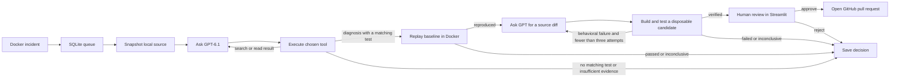

# Bug investigator

The FastAPI collector watches Docker containers listed in [targets.toml](targets.toml). It stores browser errors and unsuccessful exits in SQLite and maps stack frames to the configured source checkout. The included target is the sibling [seat-booking app](https://github.com/aikastor/faulty-app).

The baseline rejects A1 and A2 at $28 with HTTP 409. The candidate confirms the same seats at $26 with HTTP 200 and confirms A1 at $14. The full suite improves from three passes to four out of six. C4 and D2 retain their independent failures. The human review in Streamlit opened [faulty-app PR #1](https://github.com/aikastor/faulty-app/pull/1) with the verified one-line fix.

## Run the demo

Install Git, Python 3.14 and Docker with Compose, then start Docker.

For automatic diagnosis, put `OPENAI_API_KEY=your-key` in a private `.env` beside `targets.toml`, or export the key before launch. You can add the key to the file while the app is running. For private traces, see [LangSmith tracing and token usage](#langsmith-tracing-and-token-usage). Publishing an approved PR also requires the GitHub CLI.

### Quick start

```sh
git clone https://github.com/aikastor/bug-investigator.git
cd bug-investigator
python3.14 demo.py
```

If you already have the investigator checkout, run just `python3.14 demo.py` from its directory. The launcher prepares a local Python environment, clones the sibling `faulty-app` repository if needed, starts the seat-booking container and builds the browser-test image on first use. It reuses the existing demo container on subsequent launches.

Press Ctrl+C in the launcher terminal to stop the API and Streamlit. To choose different local ports, set `INVESTIGATOR_API_PORT` and `INVESTIGATOR_UI_PORT` before starting the launcher.

### Manual setup

On a fresh checkout, clone the repositories side by side and prepare the demo and browser-test images. If the faulty demo container is already running, skip the `docker compose up` line to keep its deployed image.

```sh
git clone https://github.com/aikastor/faulty-app.git
git clone https://github.com/aikastor/bug-investigator.git
cd faulty-app
docker compose up -d --build buggy-react
docker compose --profile tests build browser-tests
cd ../bug-investigator
```

In the first terminal, create the Python environment, install dependencies and start the API.

```sh
python3.14 -m venv .venv
.venv/bin/python -m pip install -r requirements.txt
.venv/bin/python -m uvicorn investigator.api:app --host 127.0.0.1 --port 8174
```

In a second terminal, open the same `bug-investigator` directory and start Streamlit.

```sh
.venv/bin/python -m streamlit run streamlit_app.py --server.address 127.0.0.1 --server.port 8514
```

For later launches, run just the Uvicorn and Streamlit commands while the demo container is running. Press Ctrl+C in each terminal to stop its service. If you change the addresses, set `INVESTIGATOR_API` for Streamlit and `INVESTIGATOR_REVIEW_UI` for the API.

### Try the demo

Open the [seat map](http://127.0.0.1:4173), select A1 and A2, and try to reserve them. Follow the investigation in the [Streamlit review app](http://127.0.0.1:8514).

Open the [API explorer](http://127.0.0.1:8174/docs). `GET /targets` shows collector status and `GET /incidents` returns the latest 100 records. The watcher polls every two seconds and scans up to 250 retained log lines from the current run. Keep exited containers until collection. Set `INVESTIGATOR_CONFIG` and `INVESTIGATOR_DB` to override the default paths. Run checks with `.venv/bin/python -m unittest discover -s tests`.

## Automatic LangGraph investigations

Each **newly collected** Docker incident is saved and queued in one SQLite transaction. The incident ID is the unique job ID. Old records already in the database are retained as history. Run the app and the collector with the same source version.

The worker checks for an OpenAI key on each poll. Jobs stay queued while no key is configured. Once a key is present, new incidents automatically send their trace and model-selected source excerpts to OpenAI using `gpt-6.1-sol`.



To try it, open the seat map, select A1 and A2, and reserve them. Open [investigations](http://127.0.0.1:8174/investigations) and select an incident to read its diagnosis and cited source lines. Expand the stack trace or tool calls for details. Use **View raw JSON** for the API representation. A supported diagnosis cites lines returned by `read_source`. The graph allows up to seven source-tool calls and one final response. It can finish early or report insufficient evidence. Provider failures are recorded on the job.

The worker claims one job at a time. Shutdown requeues active work. An expired lease lets a worker recover after a process crash. Recovery reruns the graph under the same investigation ID and may repeat a model request.

The source tools read a local in-memory snapshot of common code file types. They skip dependencies, hidden paths, symlinks and large files. The fingerprint identifies the snapshot used for a run. The configured GitHub repository supplies the publication base after approval.

### LangSmith tracing and token usage

The A1 + A2 checkout returned HTTP 409 at $28. The first patch passed the same checkout at $26 with HTTP 200. Five model responses used 9,800 input tokens and 518 output tokens, for a total of 10,318. Workspace members can inspect the timing and token counts in the [private LangSmith trace for the A1 + A2 checkout](https://smith.langchain.com/o/0784eb7b-f63d-41bc-8d8e-ccc029586b94/projects/p/cedc885d-b831-45ea-8152-4942cf96dbbc/r/49775a54-3e69-4c30-aea2-26849e623764?poll=true).

To enable tracing, set these variables in the worker environment or in the private `.env` beside `targets.toml`. Environment settings take precedence. The worker reads them when it claims a job.

```dotenv
LANGSMITH_TRACING=true
LANGSMITH_PROJECT=bug-investigator
LANGSMITH_API_KEY=your-private-langsmith-key
```

Use `LANGSMITH_ENDPOINT` for a regional or self-hosted API and `LANGSMITH_WORKSPACE_ID` for a key scoped to multiple workspaces. To run locally, omit `LANGSMITH_TRACING` or set it to `false`. Usage accounting works in either mode.

Open **Open LangSmith trace** in Streamlit to see one execution of the selected incident. The incident ID is on the root. Each lease claim gets a fresh execution ID, so searching the project for the incident ID also finds reclaimed runs. Expand a patch attempt to see proposal and verification times. A revised attempt identifies the failed replay or suite test under `revision_after`. The exporter sends operation names, timestamps, outcomes, attempt numbers, test labels, model names and token counts. Automatic capture is disabled for the investigation graph and the human-review checkpoint.

The JSON report at `/investigations/{incident_id}?format=json` includes the latest execution in `trace` and the individual Responses API calls in `usage.calls`. Each token field totals the provider's values across unique responses. A missing count makes that aggregate `null` and appears as **unknown** in Streamlit. Older investigations have `null` trace and usage. A failed investigation keeps the trace reference and any usage already received. Export failures appear as `unavailable` in the report and the worker continues to the usual review checkpoint when a candidate verifies.

### Docker baseline

For a diagnosed incident the model may select a test from the target’s configured cases. The runner accepts only those configured commands. The launcher builds the browser-test image when missing. After editing the browser tests, rebuild it with `docker compose --profile tests build browser-tests` from the app folder. The worker runs the selected case against a private copy of the watched container’s **current image**, using image defaults and a temporary internal Docker network. No replay container is watched or exposed on a host port.

The booking test records its own seat inputs, expected and actual total, and checkout response. A matching error and assertion failure produce **Bug reproduced** in the report. A passing test or an inconclusive run is recorded separately. The image IDs and observations are available in the JSON result. The controlled replay cannot identify the original customer's selection.

### Automatic patch verification

A reproduced baseline on a target with `patch_sources` and a `suite_command` starts a GPT patch proposal. The prompt includes the diagnosis, inspected source lines, observation and failed assertion. Each candidate starts from a stopped copy of the baseline image ID. The worker checks the configured source files against their hashes in the diagnosis snapshot, applies the diff in a temporary directory and copies the changed files into that container. Docker commits its filesystem as a temporary local candidate image, preserving the baseline dependencies and runtime.

The selected test runs on the candidate with the baseline command, app URL and browser-runner image ID. A fresh app instance also runs the same full suite on each side. The target’s reporter emits one `TEST_RESULT` JSON record per test, a final `TEST_PLAN` count, and `BASELINE_RESULT` observations from the booking tests. Assertions count as behavioral failures. Browser startup errors, timeouts, source mismatches and incomplete suite results are inconclusive.

Verification requires the selected test to pass in both candidate runs and every previously passing suite test to keep passing. After a behavioral failure, GPT receives the latest diff and failed assertions and can revise the patch against the original source. Each investigation allows an initial proposal and up to two revisions. Verification stops immediately on success or an inconclusive run. The worker removes temporary images, containers and networks after use.

Open the investigation to compare observations, suite results and proposed diffs. The JSON representation includes the original replay in `result.baseline`, the suite in `result.verification.baseline_suite` and candidate runs in `result.verification.attempts`. Historical records retain their original fields.

### Review and submit a fix

In Streamlit, select a verified investigation and inspect its diff and browser suite. The review graph pauses at a LangGraph interrupt. Its SQLite checkpoint survives a refresh or server restart. **Reject patch** records the decision. **Approve and open pull request** queues a background job for the repository configured in `targets.toml`. For a personal demo, set that entry to your own fork and sign in with `gh auth login` using an account with push access.

The publisher checks the GitHub base against the source fingerprint, applies the reviewed diff to a temporary clone, and opens a pull request with both checkout observations and the suite comparison. It uses a branch derived from the investigation and diff hash so retries can recover an existing branch or PR. A failed publication displays the error and a retry button. Merging is a separate GitHub action.

Approval also applies the exact verified changes as unstaged edits in the configured local checkout. The worker checks each affected file against the tested before and after hashes and preserves unrelated edits. A conflict appears in the report and can be retried from Streamlit. Previously approved reports offer **Apply approved fix locally**. The running demo continues serving its existing image. New investigations read the deployed application source even after the checkout has been fixed.

The JSON report exposes the local outcome in `result.local_patch` alongside the review decision and independent PR publication status. Run the API on loopback for this single-user demo.
